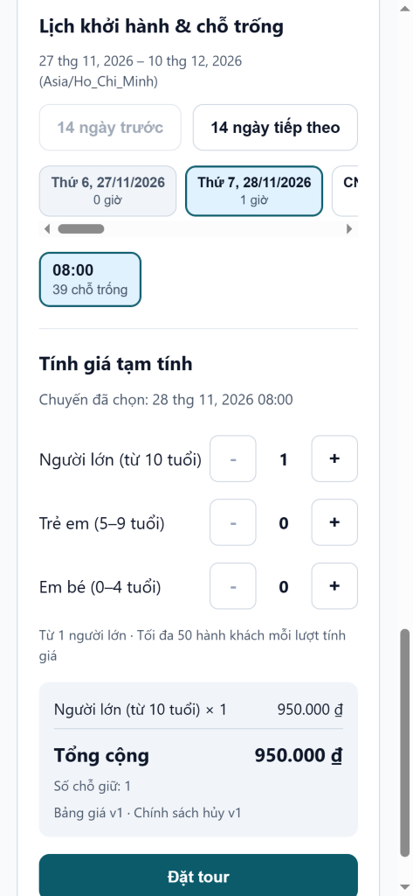
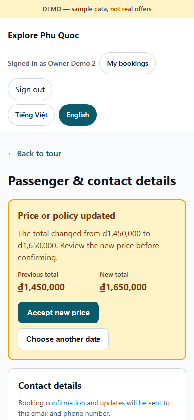
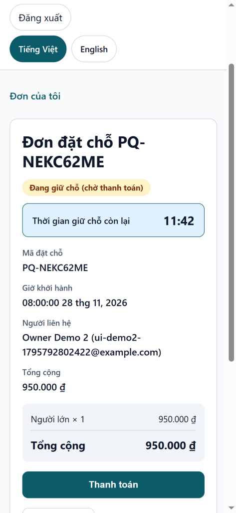
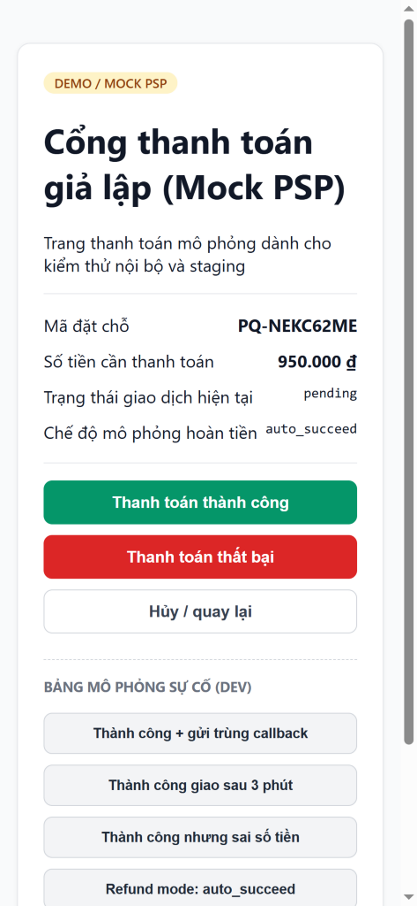
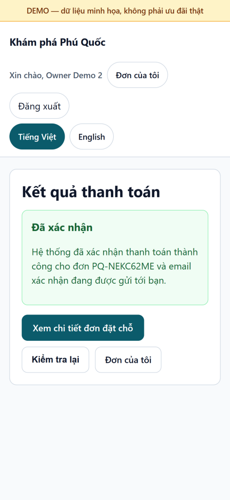
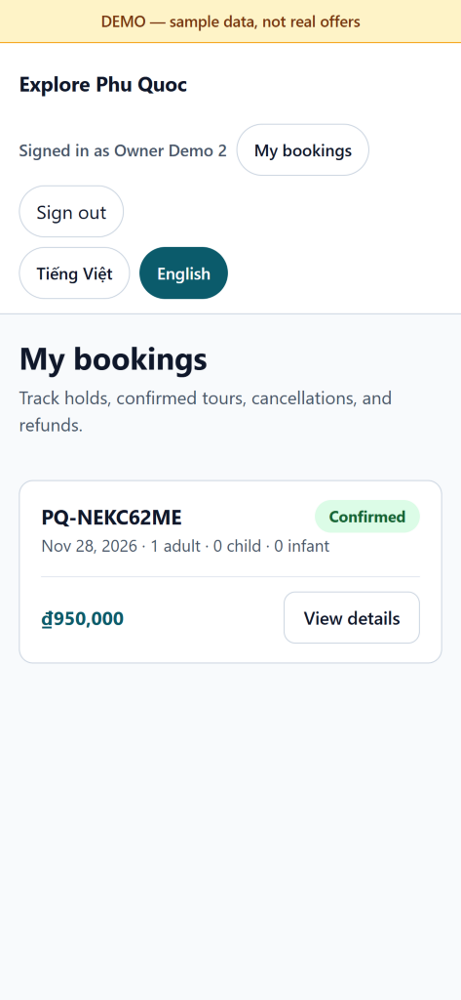
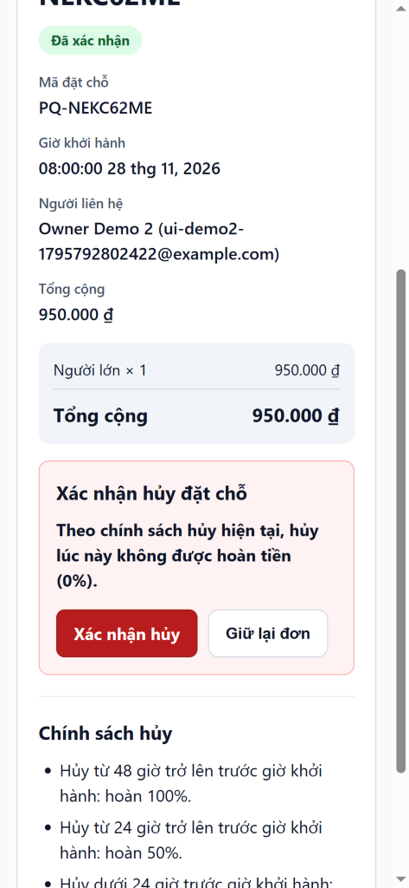
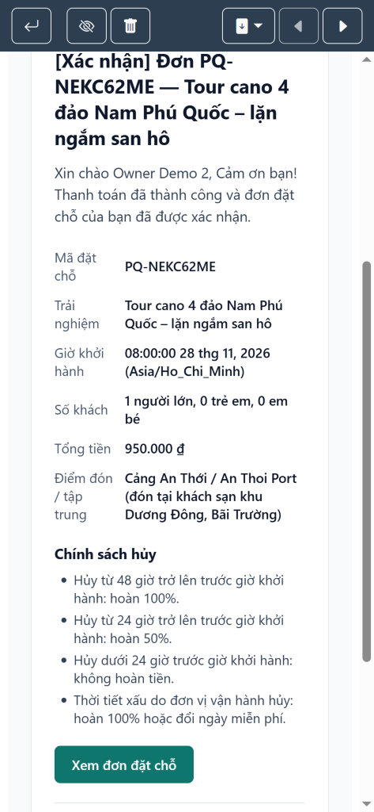

# TASK P2-09 Report — Customer Booking Web (Demo 2) + Polish U2–U4

## 1. Summary of Changes

Implemented the complete customer booking journey (Demo 2) in `apps/web` alongside read-only API support in `apps/api`, localization parity across `packages/i18n`, polish items **U2–U4**, and end-to-end verification against live staging.

### API Additions (Read-Only, Scoped)

1. **`GET /bookings/:reference/cancellation-preview`** (owner-only, DB `now()`):
   - Added [booking cancellation preview controller route](file:///home/iteso/projects/InternationalOTA/apps/api/src/modules/payments/payments.controller.ts), [RefundService.previewCancellation](file:///home/iteso/projects/InternationalOTA/apps/api/src/modules/payments/refund.service.ts), and [BookingCancellationPreviewDto](file:///home/iteso/projects/InternationalOTA/apps/api/src/modules/payments/payments.types.ts).
   - Evaluates refund using `computeRefund(...)` against DB `now()` and the booking's snapshotted cancellation policy for `confirmed` bookings (`cancellable: true`, `refundAmountMinor`, `refundPercent`, `ruleApplied`; or `cancellable: false, reason: 'too_late_to_cancel'` once past departure start), and returns `{ refundAmountMinor: '0', cancellable: true, reason: 'not_paid' }` for `held` / `payment_pending`.
   - Covered by integration tests in [refunds.spec.ts](file:///home/iteso/projects/InternationalOTA/apps/api/src/modules/payments/refunds.spec.ts) (`72h` = 100%, `30h` = 50% floor, past departure = `too_late_to_cancel`, held = `not_paid`, cross-account owner = `404`).
2. **Optional `ageBands` on `PublicQuoteResponse` (for U2)**:
   - Extended [pricing.types.ts](file:///home/iteso/projects/InternationalOTA/apps/api/src/modules/pricing/pricing.types.ts) and [PricingService.getPublicQuote](file:///home/iteso/projects/InternationalOTA/apps/api/src/modules/pricing/pricing.service.ts) to include optional read-only `ageBands` (`adult`, `child`, `infant` `minAge`/`maxAge`) derived from `pricing.price_list_items` without changing `QuoteSnapshot` or `snapshotHash`. Tested in [pricing.spec.ts](file:///home/iteso/projects/InternationalOTA/apps/api/src/modules/pricing/pricing.spec.ts).
   - No other API changes or database migrations were introduced.

### Web App (`apps/web`) & i18n (`packages/i18n`)

- **Local Dev Proxy Cleanup:** Updated [next.config.mjs](file:///home/iteso/projects/InternationalOTA/apps/web/next.config.mjs) with `rewrites()` mapping `/api/auth/:path*`, `/api/:path*`, and `/mock-psp/:path*` to `API_INTERNAL_URL` (matching [Caddyfile](file:///home/iteso/projects/InternationalOTA/deploy/staging/Caddyfile)); removed the obsolete `GET`-only proxy `apps/web/src/app/api/catalog/[...path]/route.ts`.
- **Auth & Email Verification (`D-018`):**
  - Added [/{locale}/sign-in](file:///home/iteso/projects/InternationalOTA/apps/web/src/app/[locale]/sign-in/page.tsx), [/{locale}/sign-up](file:///home/iteso/projects/InternationalOTA/apps/web/src/app/[locale]/sign-up/page.tsx), [AuthForm.tsx](file:///home/iteso/projects/InternationalOTA/apps/web/src/components/AuthForm.tsx), [HeaderAuthControls.tsx](file:///home/iteso/projects/InternationalOTA/apps/web/src/components/HeaderAuthControls.tsx), [VerifyEmailBanner.tsx](file:///home/iteso/projects/InternationalOTA/apps/web/src/components/VerifyEmailBanner.tsx), and [auth-client.ts](file:///home/iteso/projects/InternationalOTA/apps/web/src/lib/auth-client.ts).
  - Enforced relative same-origin `returnTo` sanitization (`sanitizeReturnTo`) rejecting external hosts, protocol-relative URLs (`//`), backslashes, and `javascript:` URIs.
- **Availability, Date Strip & Steppers (`U2`, `U3`, `U4`):**
  - Updated [TourAvailabilityQuote.tsx](file:///home/iteso/projects/InternationalOTA/apps/web/src/components/TourAvailabilityQuote.tsx), [QuoteSummaryPanel.tsx](file:///home/iteso/projects/InternationalOTA/apps/web/src/components/QuoteSummaryPanel.tsx), and [booking-api.ts](file:///home/iteso/projects/InternationalOTA/apps/web/src/lib/booking-api.ts):
    - **U2:** Age bands rendered directly next to pax labels (`"Người lớn (từ 10 tuổi)"`, `"Trẻ em (5–9 tuổi)"`, `"Adult (10+ yrs)"`, `"Child (5–9 yrs)"`).
    - **U3:** Compact horizontally scrollable 14-day `.dateStrip` (contained cleanly inside `390px` viewport via `minmax(0, 1fr)` / `min-width: 0`).
    - **U4:** `"Previous 14 days"` / `"14 ngày trước"` disabled on first window.
    - Enabled `"Đặt tour"` / `"Book now"` saving only last pax selection in `localStorage` (`try/catch`), redirecting unauthenticated users via `/sign-in?returnTo=...` and signed-in users directly to contact details.
- **Contact Step, Typed Hold Errors & Booking Lifecycle:**
  - Added [/{locale}/book/{departureId}](file:///home/iteso/projects/InternationalOTA/apps/web/src/app/[locale]/book/[departureId]/page.tsx) & [BookingCheckoutClient.tsx](file:///home/iteso/projects/InternationalOTA/apps/web/src/components/BookingCheckoutClient.tsx) + [PriceChangedPanel.tsx](file:///home/iteso/projects/InternationalOTA/apps/web/src/components/PriceChangedPanel.tsx) handling `Idempotency-Key` (fresh per submit, reused only on network retry), `price_changed` comparison requiring explicit `"Accept new price"`, `sold_out` / `closed` / `cutoff_passed` recovery link, and `too_many_active_holds` `"My bookings"` link.
  - Added [/{locale}/bookings/{reference}](file:///home/iteso/projects/InternationalOTA/apps/web/src/app/[locale]/bookings/[reference]/page.tsx) & [BookingDetailClient.tsx](file:///home/iteso/projects/InternationalOTA/apps/web/src/components/BookingDetailClient.tsx) + [CancelConfirmPanel.tsx](file:///home/iteso/projects/InternationalOTA/apps/web/src/components/CancelConfirmPanel.tsx) with server-clock calibrated hold countdown (refreshed on `focus`), email verification gate disabling Pay, U1 policy sentences, in-page cancel preview confirmation panel (`no window.alert/confirm`), and live refund status card.
  - Added [/{locale}/bookings/{reference}/return](file:///home/iteso/projects/InternationalOTA/apps/web/src/app/[locale]/bookings/[reference]/return/page.tsx) & [ReturnStatusClient.tsx](file:///home/iteso/projects/InternationalOTA/apps/web/src/components/ReturnStatusClient.tsx) ignoring URL query params and polling `GET /api/bookings/:reference` every `2s` up to `60s`.
  - Added [/{locale}/me/bookings](file:///home/iteso/projects/InternationalOTA/apps/web/src/app/[locale]/me/bookings/page.tsx) & [MyBookingsClient.tsx](file:///home/iteso/projects/InternationalOTA/apps/web/src/components/MyBookingsClient.tsx) cursor-paginated bookings list.
- **i18n & Hygiene:** All copy stored in [en.json](file:///home/iteso/projects/InternationalOTA/packages/i18n/messages/en.json) & [vi.json](file:///home/iteso/projects/InternationalOTA/packages/i18n/messages/vi.json) (zero hardcoded JSX literals confirmed by [browse.spec.tsx](file:///home/iteso/projects/InternationalOTA/apps/web/src/app/browse.spec.tsx)); zero `window.alert`/`window.confirm` confirmed by [booking-web.spec.tsx](file:///home/iteso/projects/InternationalOTA/apps/web/src/app/booking-web.spec.tsx); zero new npm dependencies added.

---

## 2. Live Staging Verification & E2E Script (`AC1`)

- **Staging Tunnel URL:** `https://drinking-initiated-banner-variable.trycloudflare.com` (Basic Auth credentials stored outside VCS in `deploy/staging/.env.staging`).
- Executed [scripts/e2e-demo2.mjs](file:///home/iteso/projects/InternationalOTA/scripts/e2e-demo2.mjs) directly against the live staging tunnel (`exit 0`):

```text
[e2e-demo2] Target BASE_URL=https://drinking-initiated-banner-variable.trycloudflare.com
[e2e-demo2] Target MAILPIT_URL=https://drinking-initiated-banner-variable.trycloudflare.com/mailpit
[e2e-demo2] Email verified for e2e-demo2-1795792642059-2749f7@example.com
[e2e-demo2] Signed in cleanly (verified session)
[e2e-demo2] Quoted tour=pq-p208-vi-a77bf7f6 dep=2026-12-09 total=1.000.000 ₫
[e2e-demo2] Hold created: ref=PQ-T9JWGWAA status=held
[e2e-demo2] Submitted Mock PSP Pay successfully
[e2e-demo2] Server confirmed booking ref=PQ-T9JWGWAA
[e2e-demo2] Mailpit verified 2 booking emails (held + confirmed)
[e2e-demo2] Cancellation preview: 100% (1000000 VND)
[e2e-demo2] Refund succeeded: amount=1000000 status=succeeded
[e2e-demo2] PASS — all steps verified for PQ-T9JWGWAA
```

---

## 3. Mobile Screenshots at 390px (`AC5`)

All 8 screenshots were captured on the live staging tunnel (`390x844` mobile viewport):

1. **Date strip with age bands (`vi`):** 
2. **`price_changed` dialog (`en`):** 
3. **Booking page with countdown (`vi`):** 
4. **Mock payment page:** 
5. **Confirmed status (`vi`):** 
6. **My bookings (`en`):** 
7. **Cancel preview (`vi`):** 
8. **Mailpit confirmed email (`vi`):** 

---

## 4. Accessibility Smoke (`AC4`) & Workspace Verification (`AC2`, `AC3`, `AC6`)

- **Accessibility smoke:** Semantic `h1` → `h2` → `h3` hierarchy across every page; explicit `<label htmlFor="...">` bindings on all auth and booking contact inputs; visible `:focus-visible` outlines (`3px solid #0284c7`); `44px+` minimum tap targets on buttons/chips/steppers; `aria-live="polite"` / `aria-live="assertive"` on quote summary, email verification banner, hold countdown, payment return status, and cancel confirm panel.
- **No client trust (`AC3`):** Booking totals are re-quoted server-side via `expectedSnapshotHash` (`BookingService`), verified live via staging `409 price_changed` (`₫1,450,000` -> `₫1,650,000`); return page polls server state exclusively and displays `Still processing` when status is `payment_pending` regardless of URL query params ([booking-web.spec.tsx](file:///home/iteso/projects/InternationalOTA/apps/web/src/app/booking-web.spec.tsx)).
- **Workspace CI checks passed cleanly:**
  - `pnpm format:check` — passed
  - `pnpm lint` — passed (`eslint` across all 7 workspace projects + `tools`)
  - `pnpm lint:boundaries` — passed (`no dependency violations found (156 modules, 747 dependencies cruised)`)
  - `pnpm typecheck` & `pnpm build` & `pnpm db:generate` — passed
  - `pnpm licenses:check` & `pnpm audit --prod --audit-level high` — passed
  - `pnpm test` against PostgreSQL:
    - `@internationalota/web`: **3 test files passed, 16 tests passed** (`page.spec.ts`, `browse.spec.tsx`, `booking-web.spec.tsx`)
    - `@internationalota/api`: **18 test files passed, 139 tests passed**
    - `tools/check-licenses.spec.ts`: **1 test file passed, 16 tests passed**
    - All shared packages (`@internationalota/money`, `@internationalota/time`, `@internationalota/shared`, `@internationalota/db`, `@internationalota/i18n`): passed
