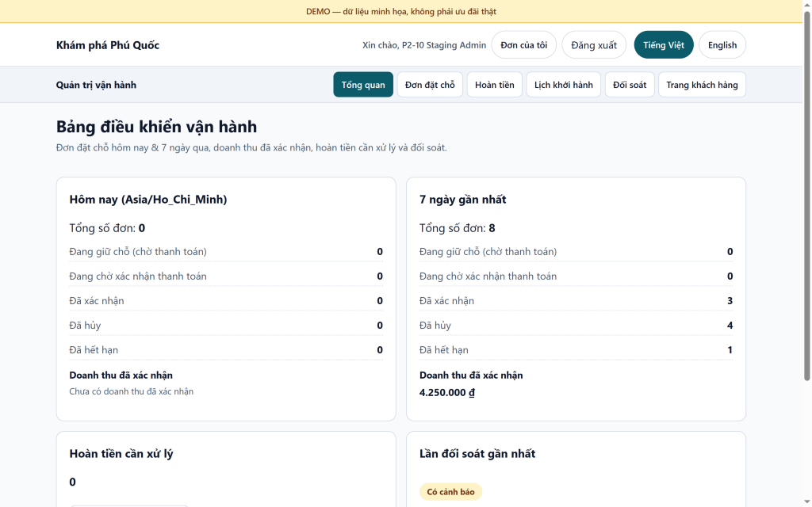
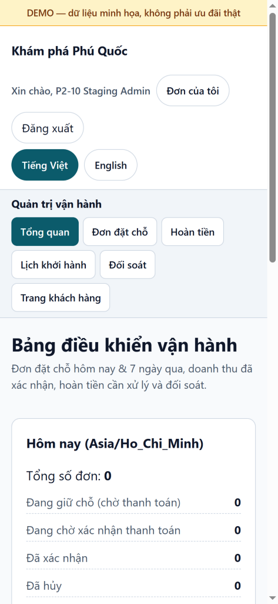
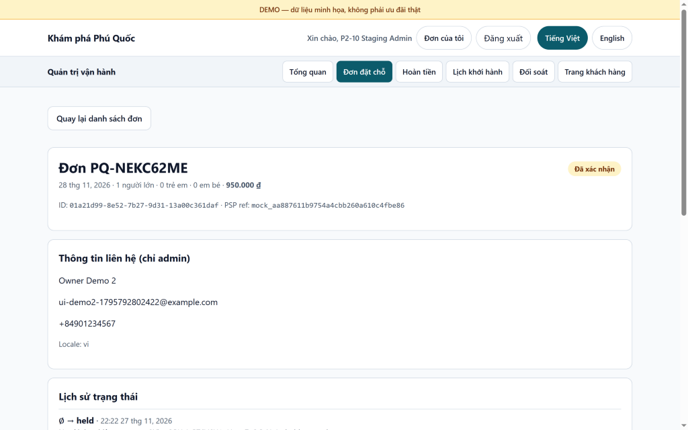
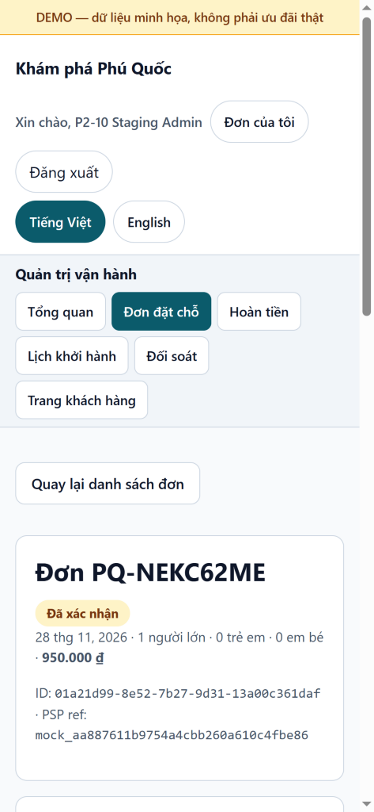
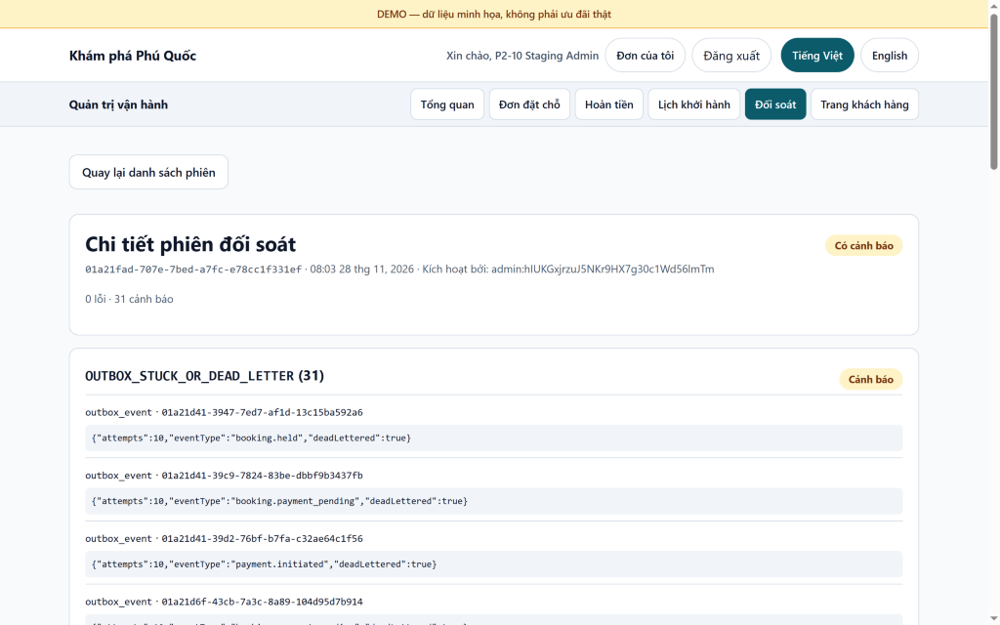
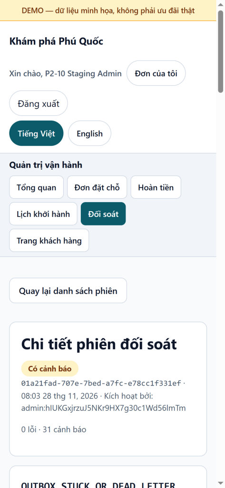

# TASK P2-10 Report — Daily Reconciliation & Minimal Admin Console

## 1. Summary of Changes

Implemented cross-module daily/manual reconciliation (`ops` module), immutable operational audit logging (`ops.admin_audit`), guarded local/staging admin role provisioning (`pnpm admin:grant`), and a bilingual role-protected Admin Web console (`/{locale}/admin/*`) with zero new npm dependencies and zero `window.alert` / `window.confirm` calls.

### Database Schema, Migrations & Grants

- **[ops.ts](file:///home/iteso/projects/InternationalOTA/packages/db/src/schema/ops.ts)** & **[schema/index.ts](file:///home/iteso/projects/InternationalOTA/packages/db/src/schema/index.ts):** Added `ops.reconciliation_runs`, `ops.reconciliation_findings`, and `ops.admin_audit`.
- **[0019_fast_stepford_cuckoos.sql](file:///home/iteso/projects/InternationalOTA/packages/db/migrations/0019_fast_stepford_cuckoos.sql):** Creates the `ops` schema tables, indexes, and foreign key (`finding.run_id -> reconciliation_runs.id`).
- **[0020_ops_immutability_triggers.sql](file:///home/iteso/projects/InternationalOTA/packages/db/migrations/0020_ops_immutability_triggers.sql):** Enforces append-only immutability on `ops.admin_audit` and `ops.reconciliation_findings` (blocks `UPDATE`/`DELETE`), and restricts `ops.reconciliation_runs` updates to terminal transitions (`running` -> `ok` | `warnings` | `errors`) while blocking `DELETE`.
- **[roles.ts](file:///home/iteso/projects/InternationalOTA/packages/db/src/roles.ts):** Granted `ota_app` `SELECT, INSERT, UPDATE` on `ops.reconciliation_runs` and `SELECT, INSERT` on `ops.reconciliation_findings` and `ops.admin_audit`.

### Module Boundaries & Reconciliation Orchestration (`ops`)

- **[packages/shared/src/index.ts](file:///home/iteso/projects/InternationalOTA/packages/shared/src/index.ts):** Defined public cross-module port symbols (`ADMIN_AUDIT_PORT`, `BOOKING_SEAT_SUMS_PORT`, `LEDGER_BOOKING_EXPECTATION_PORT`, `LEDGER_PAYMENT_EXPECTATION_PORT`, `BOOKING_ADMIN_PAYMENT_PORT`, `BOOKING_ADMIN_NOTIFICATION_PORT`, `OPS_RECONCILIATION_WORKER_PORT`, `ReconciliationFinding`).
- **Owning modules (`runReconciliationChecks(asOf)`):**
  - [inventory.service.ts](file:///home/iteso/projects/InternationalOTA/apps/api/src/modules/inventory/inventory.service.ts) & [inventory-admin.controller.ts](file:///home/iteso/projects/InternationalOTA/apps/api/src/modules/inventory/inventory-admin.controller.ts)
  - [booking.service.ts](file:///home/iteso/projects/InternationalOTA/apps/api/src/modules/booking/booking.service.ts) & [booking-admin.controller.ts](file:///home/iteso/projects/InternationalOTA/apps/api/src/modules/booking/booking-admin.controller.ts) (including PII redaction on list responses and explicit customer contact on `GET /admin/bookings/:reference`)
  - [payments.service.ts](file:///home/iteso/projects/InternationalOTA/apps/api/src/modules/payments/payments.service.ts), [refund.service.ts](file:///home/iteso/projects/InternationalOTA/apps/api/src/modules/payments/refund.service.ts), & [refund-admin.controller.ts](file:///home/iteso/projects/InternationalOTA/apps/api/src/modules/payments/refund-admin.controller.ts) (`GET /admin/refunds`, transactional `ops.admin_audit` in `adminRetryRefund` and single-transaction `cancelDeparture`)
  - [ledger.service.ts](file:///home/iteso/projects/InternationalOTA/apps/api/src/modules/finance/ledger.service.ts)
  - [outbox.service.ts](file:///home/iteso/projects/InternationalOTA/apps/api/src/modules/messaging/outbox.service.ts) & [job-queue.service.ts](file:///home/iteso/projects/InternationalOTA/apps/api/src/modules/messaging/job-queue.service.ts) (`QUEUE_OPS_DAILY_RECONCILIATION` scheduled `'0 2 * * *'` with `tz: 'Asia/Ho_Chi_Minh'`)
  - [notifications.service.ts](file:///home/iteso/projects/InternationalOTA/apps/api/src/modules/notifications/notifications.service.ts)
- **`ops` module ([ops.service.ts](file:///home/iteso/projects/InternationalOTA/apps/api/src/modules/ops/ops.service.ts), [ops-admin.controller.ts](file:///home/iteso/projects/InternationalOTA/apps/api/src/modules/ops/ops-admin.controller.ts), [ops.module.ts](file:///home/iteso/projects/InternationalOTA/apps/api/src/modules/ops/ops.module.ts)):**
  - Imports sibling modules strictly via their public barrel `index.ts` / shared ports.
  - Acquires a dedicated `pg` session advisory lock (`pg_try_advisory_lock(72100001)`), returning HTTP `409 already_running` (`ops.reconciliation.alreadyRunning`) on concurrent execution attempts.
  - Records `ops.admin_audit` (`reconciliation_run`), runs all 6 read-only module check suites against `asOf`, persists findings, emits `ops.reconciliation_errors` via outbox + error log when `errors > 0`, and exposes `GET /admin/dashboard`, `POST /admin/reconciliation/runs` (`@Idempotent()`), `GET /admin/reconciliation/runs`, and `GET /admin/reconciliation/runs/:id`.

### Role Provisioning CLI (`admin:grant`) & Staging Queue Bootstrap

- **[admin-grant.ts](file:///home/iteso/projects/InternationalOTA/apps/api/src/scripts/admin-grant.ts):** Grants `'admin'` or `'operator'` locally/on staging while writing an `admin_role_grant` row in `ops.admin_audit`. Refuses `APP_ENV=production` (exit code `1`) with SQL runbook instructions:
  - Verified live CLI output under `APP_ENV=production`:
    ```text
    Refusing to run admin:grant in APP_ENV=production.
    Production role grants must follow the documented SQL runbook instead of CLI scripts:
      BEGIN;
      INSERT INTO identity.user_roles (user_id, role) SELECT id, 'admin' FROM identity."user" WHERE email = '<email>' ON CONFLICT DO NOTHING;
      INSERT INTO ops.admin_audit (id, actor_user_id, action, target_type, target_id, reason) VALUES (gen_random_uuid(), 'runbook:<operator>', 'admin_role_grant', 'user_role', '<user_id>:admin', '<ticket_ref>');
      COMMIT;
    EXIT=1
    ```
- **[staging-migrate.ts](file:///home/iteso/projects/InternationalOTA/apps/api/src/scripts/staging-migrate.ts):** Ensures `QUEUE_OPS_DAILY_RECONCILIATION` is provisioned during staging migration.

### Minimal Admin Web (`/{locale}/admin/*`)

- Added [admin-api.ts](file:///home/iteso/projects/InternationalOTA/apps/web/src/lib/admin-api.ts), [AdminShell.tsx](file:///home/iteso/projects/InternationalOTA/apps/web/src/components/admin/AdminShell.tsx), [AdminDashboardClient.tsx](file:///home/iteso/projects/InternationalOTA/apps/web/src/components/admin/AdminDashboardClient.tsx), [AdminBookingsClient.tsx](file:///home/iteso/projects/InternationalOTA/apps/web/src/components/admin/AdminBookingsClient.tsx), [AdminBookingDetailClient.tsx](file:///home/iteso/projects/InternationalOTA/apps/web/src/components/admin/AdminBookingDetailClient.tsx), [AdminRefundsClient.tsx](file:///home/iteso/projects/InternationalOTA/apps/web/src/components/admin/AdminRefundsClient.tsx), [AdminDeparturesClient.tsx](file:///home/iteso/projects/InternationalOTA/apps/web/src/components/admin/AdminDeparturesClient.tsx), [AdminReconciliationListClient.tsx](file:///home/iteso/projects/InternationalOTA/apps/web/src/components/admin/AdminReconciliationListClient.tsx), [AdminReconciliationDetailClient.tsx](file:///home/iteso/projects/InternationalOTA/apps/web/src/components/admin/AdminReconciliationDetailClient.tsx), and routes under `apps/web/src/app/[locale]/admin/`.
- All strings live in [en.json](file:///home/iteso/projects/InternationalOTA/packages/i18n/messages/en.json) and [vi.json](file:///home/iteso/projects/InternationalOTA/packages/i18n/messages/vi.json); all confirmations (refund retry, close/reopen/cancel departure) use in-page panels with zero `window.alert`/`window.confirm`.
- Responsive styling added in [globals.css](file:///home/iteso/projects/InternationalOTA/apps/web/src/styles/globals.css); covered by [admin-web.spec.tsx](file:///home/iteso/projects/InternationalOTA/apps/web/src/app/admin-web.spec.tsx).

---

## 2. Reconciliation Check Catalogue

| Owning Module | Check Code | Severity | Invariant Checked |
| --- | --- | --- | --- |
| `inventory` | `INVENTORY_VERIFY_ALLOCATED_MISMATCH` | `error` | `inventory.verify_allocated()` returns empty |
| `inventory` | `INVENTORY_BOOKING_SEAT_SUM_MISMATCH` | `error` | `departures.allocated` equals `SUM(booking.seats)` across active holds/bookings |
| `payments` | `BOOKING_CONFIRMED_MISSING_SUCCEEDED_ATTEMPT` | `error` | Every `confirmed` booking has a `succeeded` payment attempt |
| `payments` | `BOOKING_CONFIRMED_MULTIPLE_SUCCEEDED_ATTEMPTS` | `error` | No `confirmed` booking has >1 `succeeded` payment attempt |
| `payments` | `PAYMENT_AMOUNT_MISMATCH` | `error` | Succeeded payment amount matches `booking.total_minor` |
| `payments` | `PAYMENT_CURRENCY_MISMATCH` | `error` | Succeeded payment currency matches `booking.currency` |
| `payments` | `BOOKING_PAYMENT_REF_MISMATCH` | `error` | Succeeded `psp_ref` matches booking payment reference |
| `payments` | `PAYMENT_SUCCEEDED_INVALID_BOOKING_STATUS` | `error` | Succeeded payment attempt points to valid post-payment booking status |
| `payments` | `PAYMENT_REFUND_REQUIRED_MISSING_REFUND` | `error` | `refund_required` attempts have a corresponding refund record |
| `payments` | `PSP_SETTLEMENT_MISSING_ATTEMPT` | `error` | Every `mock_psp_transactions` settlement links to a `succeeded` attempt |
| `payments` | `PSP_SETTLEMENT_AMOUNT_MISMATCH` | `error` | `mock_psp_transactions` amount/currency matches `payment_attempts` |
| `payments` | `ATTEMPT_MISSING_PSP_SETTLEMENT` | `error` | Every `succeeded` attempt has a settled `mock_psp_transactions` row |
| `payments` | `PAYMENT_STUCK_INITIATED` | `warning` | Payment attempts stuck in `initiated` past 60 minutes |
| `payments` | `REFUND_MANUAL_REVIEW` | `warning` | Refunds flagged for `manual_review` |
| `booking` | `BOOKING_OVERDUE_HOLD` | `warning` | `held`/`payment_pending` bookings overdue past `hold_expires_at + 5 min` |
| `finance` | `LEDGER_UNBALANCED_ENTRY` | `error` | Every `finance.journal_entries` document balances (`SUM(debits) = SUM(credits)`) per currency (`je.posted_at <= asOf`) |
| `finance` | `LEDGER_PSP_CLEARING_MISMATCH` | `error` | `asset:psp_clearing` balance equals net settled payments minus refunds per currency |
| `finance` | `LEDGER_CUSTOMER_PREPAYMENTS_MISMATCH` | `error` | `liability:customer_prepayments` excludes cancelled bookings and matches non-cancelled confirmed totals |
| `finance` | `LEDGER_REFUNDS_PAYABLE_MISMATCH` | `error` | `liability:refunds_payable` equals open refund liability per currency |
| `messaging` | `OUTBOX_STUCK_OR_DEAD_LETTER` | `warning` | Outbox events dead-lettered or unpublished with `attempts > 5` |
| `notifications` | `EMAIL_DEAD` | `warning` | `email_messages` rows with `status = 'dead'` |

---

## 3. Mutation Tests (a–d)

All four required mutations were injected, executed against [ops.spec.ts](file:///home/iteso/projects/InternationalOTA/apps/api/src/modules/ops/ops.spec.ts), observed to fail, and reverted cleanly:

| Mutation | Target Location | Injected Fault | Result & Killed Test |
| --- | --- | --- | --- |
| **(a)** | `apps/api/src/modules/inventory/inventory.service.ts` | Skipped the seat-sum mismatch comparison loop | **Killed** by `AC2(a)` at `ops.spec.ts:658:23` (`expected [ Array(1) ] to include 'INVENTORY_BOOKING_SEAT_SUM_MISMATCH'`) |
| **(b)** | `apps/api/src/modules/booking/booking.service.ts` | Included `'cancelled'` in `getConfirmedTotalsByCurrency` | **Killed** by `AC1` at `ops.spec.ts:560:36` (`expected 'errors' to be 'ok'`) |
| **(c)** | `apps/api/src/modules/ops/ops.service.ts` | Bypassed the `pg_try_advisory_lock` contention guard | **Killed** by `AC4` at `ops.spec.ts:1006:60` (`expected 200 to be 409`) |
| **(d)** | `apps/api/src/modules/payments/refund.service.ts` | Wrote `ops.admin_audit` on `this.db` outside the rollback `tx` | **Killed** by `AC6` at `ops.spec.ts:1036:26` (`expected [ { …(8) } ] to have a length of +0 but got 1`) |

### Module Boundary Proof (`lint:boundaries`)

- Temporarily added an illegal sibling internal import (`../booking/booking.service.js`) inside `ops.service.ts` and ran `pnpm lint:boundaries`:
  - Failed as expected: `error no-sibling-module-internal-imports: apps/api/src/modules/ops/ops.service.ts → apps/api/src/modules/booking/booking.service.ts` (`1 dependency violations (1 errors, 0 warnings). 165 modules, 837 dependencies cruised.`).
- Reverted the test import and confirmed `pnpm lint:boundaries` passes with 0 violations.

---

## 4. Live Staging Verification & Output

- **Staging Tunnel URL:** `https://motion-guards-letting-wings.trycloudflare.com`
- **Granted staging admin role (`pnpm admin:grant`):**
  ```json
  {"granted":true,"userId":"hIUKGxjrzuJ5NKr9HX7g30c1Wd56lmTm","email":"p210-staging-admin@example.com","role":"admin","auditId":"01a21fad-6e1b-7c59-823f-b38a338ef24f","appEnv":"staging"}
  ```
- **Manual staging reconciliation (`POST /api/admin/reconciliation/runs`):**
  - Run ID: `01a21fad-707e-7bed-a7fc-e78cc1f331ef`
  - Status: `"warnings"`
  - Counts: `{"checks":6,"errors":0,"warnings":31,"totalFindings":31}`
  - Triggered by: `"admin:hIUKGxjrzuJ5NKr9HX7g30c1Wd56lmTm"`
  - Findings: 31 `OUTBOX_STUCK_OR_DEAD_LETTER` warnings from historical pre-existing staging outbox rows (`attempts: 10`, `deadLettered: true`); 0 errors across inventory, booking, payments, ledger, and notifications.

---

## 5. Admin Console Screenshots (390px & 1280px, `vi`)

Captured on live staging in Vietnamese (`vi`), verified with zero horizontal overflow at `390x844` (`html`/`body`/`main` bounding box width `374.8px`, 0 overflowing controls) and `1280x800`:

1. **Dashboard (`1280x800`):** 
2. **Dashboard (`390x844`):** 
3. **Booking Detail (`PQ-NEKC62ME`, `1280x800`):** 
4. **Booking Detail (`PQ-NEKC62ME`, `390x844`):** 
5. **Reconciliation Run Detail (`01a21fad-707e-7bed-a7fc-e78cc1f331ef`, `1280x800`):** 
6. **Reconciliation Run Detail (`01a21fad-707e-7bed-a7fc-e78cc1f331ef`, `390x844`):** 
