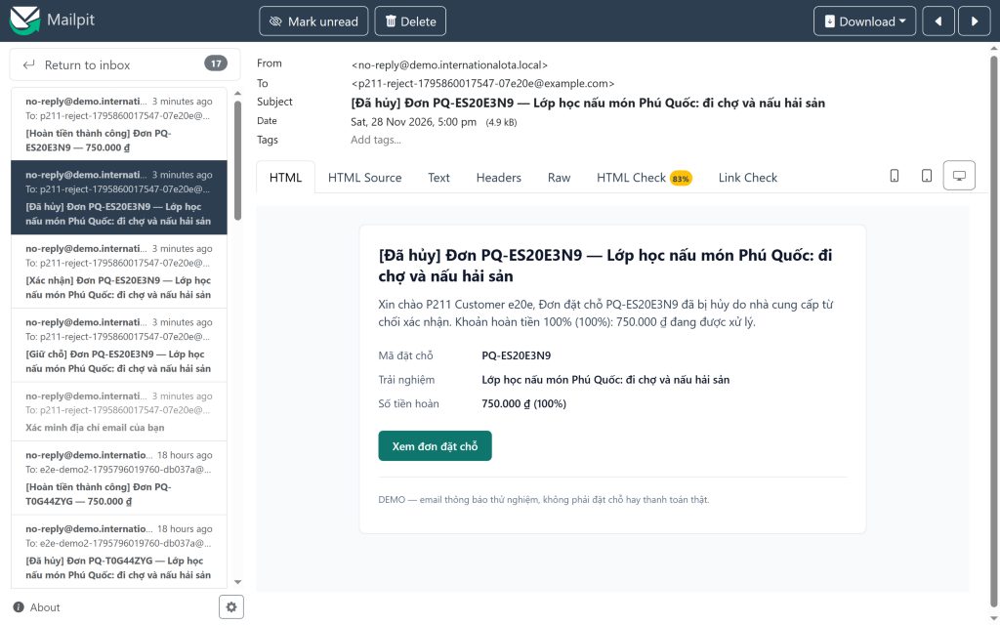

# TASK-P2-11 Report — Mandatory Failure-Scenario Suite + Supplier Reject

## 1. Phạm vi triển khai

- **Part A — Supplier reject (`POST /admin/bookings/:reference/reject`)**:
  - Migration forward [`0022_silly_mathemanic.sql`](../packages/db/migrations/0022_silly_mathemanic.sql) mở rộng constraint `refunds_reason_check` trong `packages/db/src/schema/payments.ts` để chấp nhận `'supplier_rejected'`.
  - Thêm action `'booking_reject'` vào `AdminAuditAction` (`packages/shared/src/index.ts`).
  - Triển khai `RefundService.rejectConfirmedBooking` (`apps/api/src/modules/payments/refund.service.ts`) dùng chung helper transactional `cancelConfirmedAndQueueFullRefundInTx` (cùng luồng với `executeDepartureBookingCancel`), fail-closed `ADMIN_AUDIT_PORT` (`action: 'booking_reject'`), giải phóng ghế trong cùng DB transaction, hoàn tiền 100% (`reason: 'supplier_rejected'`, bút toán `Dr liability:prepayments / Cr liability:refunds_payable`) kể cả khi đã qua cutoff hủy của khách, và idempotent với `@Idempotent()`.
  - Controller [`refund-admin.controller.ts`](../apps/api/src/modules/payments/refund-admin.controller.ts) mở route `POST /admin/bookings/:reference/reject` (`@Roles('admin', 'operator')`, `@Idempotent()`).
  - Email `booking.cancelled` (`packages/i18n/messages/{en,vi}.json`, `apps/api/src/modules/notifications/email-renderer.service.ts`) hiển thị thông báo riêng khi `cancellationReason` bắt đầu bằng `'supplier_rejected:'` (nêu rõ nhà cung cấp không xác nhận được và hoàn tiền 100%).
  - Admin Web (`apps/web/src/components/admin/AdminBookingDetailClient.tsx`, `apps/web/src/lib/admin-api.ts`) bổ sung nút **Reject booking** với panel xác nhận ngay trên trang kèm lý do bắt buộc (không dùng `window.alert` / `window.confirm`).
- **Part B — Test-only Crash Injection (`FaultInjector`)**:
  - Thêm [`apps/api/src/common/fault-injection/`](../apps/api/src/common/fault-injection/fault-injector.service.ts) (`FaultInjectionModule`, `FaultInjector`, `SimulatedCrash`).
  - Guard hai lớp: `FaultInjectionModule.onModuleInit` từ chối khởi chạy khi `APP_ENV=production`; `FaultInjector` là no-op hoàn toàn trừ khi đồng thời `APP_ENV=test` và `FAULT_INJECTION=1`. Production `AppModule` không import `FaultInjectionModule` — các service chỉ inject `@Optional() @Inject(FaultInjector)`.
- **Part C — 8 Failure Scenarios & CI**:
  - Suite 8 kịch bản black-box tại `apps/api/test/failure-scenarios/fs-01-…` đến `fs-08-…`, mỗi test khởi tạo isolated DB + drain worker và kết thúc bằng `POST /admin/reconciliation/runs` đạt `status === 'ok'` (0 error, 0 warning).
  - Thêm script `test:failure-scenarios` ở root `package.json` và `apps/api/package.json`, tách khỏi `pnpm test` mặc định và chạy riêng step **Failure scenarios** trong `.github/workflows/ci.yml` (`APP_ENV: test`, `FAULT_INJECTION: '1'`).
- **Part D — Follow-ups**:
  - `decodeBookingCursor` (`apps/api/src/modules/booking/booking.service.ts`) kiểm tra regex ISO-8601 tối đa 6 chữ số thập phân giây kết thúc bằng `Z` và ngày hợp lệ, trả về HTTP 400 (`booking_invalid_query`) khi cursor sai định dạng (`apps/api/src/modules/booking/booking.spec.ts`).
  - Chuyển helper DB test (`test-database.ts`) sang subpath `@internationalota/db/testing` trong `packages/db/package.json`, loại bỏ khỏi runtime entrypoint `packages/db/src/index.ts`, cập nhật `apps/api/test/test-db.ts` và thêm guard test trong `packages/db/test/db.spec.ts`.

### Recovery gaps phát hiện và khắc phục từ FS-05

1. **`checkout.after_provider_before_tx2`**: Nếu API sập sau khi tạo phiên ở PSP nhưng trước khi ghi `provider_ref` vào `payments.payment_attempts`, lần giao webhook sớm hoặc job đối soát trước đây không tìm được `providerRef`. Đã bổ sung `PaymentProvider.getCheckoutByAttemptId?` (triển khai ở `MockPaymentProvider`) và `PaymentsService.recoverAttemptProviderRef` trong `reconcilePending` để khôi phục `provider_ref` từ provider trước khi đối soát trạng thái.
2. **`refund.after_processing_before_provider`**: Nếu worker sập sau khi chuyển refund sang `'processing'` nhưng trước khi gửi sang PSP, dòng `'processing'` không có `provider_refund_ref` bị mắc kẹt vô thời hạn (trigger state-machine chỉ cho `processing -> failed -> processing`). Đã bổ sung cơ chế reclaim cho bản ghi `'processing'` quá hạn với `provider_refund_ref IS NULL` qua chuyển trạng thái hợp lệ `processing -> failed -> processing`, và re-throw `SimulatedCrash` ra ngoài khối catch nghiệp vụ để test fault-injection mô phỏng sập process thật.

---

## 2. Bảng 8 kịch bản Failure Scenarios (`fs-01` – `fs-08`)

| #     | Spec file                                | Tình huống                                                                                                                                       | Kết quả kiểm chứng                                                                                                                                                      | Đối soát cuối        |
| ----- | ---------------------------------------- | ------------------------------------------------------------------------------------------------------------------------------------------------ | ----------------------------------------------------------------------------------------------------------------------------------------------------------------------- | -------------------- |
| FS-01 | `fs-01-last-seat-concurrency.spec.ts`    | 50 request `POST /bookings` đồng thời cho chiếc ghế cuối cùng (`capacity = 1`)                                                                   | Đúng 1 hold thành công -> thanh toán PSP -> `confirmed`; 49 request còn lại nhận HTTP 409 (`sold_out`); `inventory.departures.allocated = 1`                            | `ok` (0 err, 0 warn) |
| FS-02 | `fs-02-double-pay-click.spec.ts`         | Double pay: (a) cùng `Idempotency-Key` 5 lần song song; (b) 2 `Idempotency-Key` khác nhau cùng thanh toán `success`                              | (a) gom về 1 `payment_attempt` & 1 bút toán; (b) 1 attempt `confirmed`, attempt thứ 2 `refund_required` (`double_payment`) -> auto-refund 100% (`succeeded`)            | `ok` (0 err, 0 warn) |
| FS-03 | `fs-03-duplicate-early-webhook.spec.ts`  | Crash tại `checkout.after_provider_before_tx2` khiến webhook PSP đến trước khi DB có `provider_ref` + giao đồng thời 5 bản sao webhook           | Dedup `inbox.messages` chỉ xử lý 1 lần; `reconcilePending` khôi phục `provider_ref` và đồng bộ xác nhận thành công, đúng 1 ledger confirmation                          | `ok` (0 err, 0 warn) |
| FS-04 | `fs-04-supplier-reject.spec.ts`          | Đặt chỗ `confirmed` bị admin từ chối qua `POST /admin/bookings/:reference/reject` (+ test guard auth/status/idempotency + outbox rollback check) | Hủy sang `cancelled`, hoàn 100% (`reason: 'supplier_rejected'`, `succeeded`), giải phóng ghế atomic trong TX, email xác nhận hủy do nhà cung cấp gửi ra                 | `ok` (0 err, 0 warn) |
| FS-05 | `fs-05-crash-mid-saga.spec.ts`           | Guard `FaultInjectionModule` + chèn `SimulatedCrash` tại cả 5 fault point trong quy trình checkout -> confirm -> reject -> refund                | `APP_ENV=production` refuse khởi động `FaultInjectionModule`, tắt khi `FAULT_INJECTION!=1`; cả 5 điểm crash đều hồi phục qua retry/reconciler/outbox, không mất dữ liệu | `ok` (0 err, 0 warn) |
| FS-06 | `fs-06-hold-expiry-payment-race.spec.ts` | 20 vòng đua đồng thời giữa job hết hạn giữ chỗ (`expireDue`) và webhook thanh toán PSP thành công                                                | Không bao giờ vừa `expired` vừa mất ghế, hay `confirmed` không ghế: hoặc `confirmed + allocated=1`, hoặc `expired + refund_required -> succeeded`                       | `ok` (0 err, 0 warn) |
| FS-07 | `fs-07-price-change-before-pay.spec.ts`  | Báo giá cũ trong lúc admin cập nhật giá tour mới; khách cố giữ chỗ bằng `expectedSnapshotHash` cũ rồi giữ lại theo hash mới                      | Hash cũ bị HTTP 409 `price_changed` + trả về báo giá mới; hold với hash mới tạo đơn và thanh toán đúng tổng tiền mới                                                    | `ok` (0 err, 0 warn) |
| FS-08 | `fs-08-cancel-during-confirm.spec.ts`    | Guard `expectedVersion` lỗi thời + 20 vòng đua đồng thời giữa `cancel` và `confirm` từ webhook                                                   | Update stale version bị từ chối; 20/20 vòng cho kết quả nhất quán: `confirmed` giữ 1 ghế không refund hoặc `cancelled` hoàn 100% tiền giải phóng ghế                    | `ok` (0 err, 0 warn) |

---

## 3. Bảng 5 Fault Points (`FaultInjector`)

| Fault point                                  | Vị trí (`file:line`)                                    | Cơ chế hồi phục                                                                                                                                        | Trạng thái cuối sau recovery                                                                       |
| -------------------------------------------- | ------------------------------------------------------- | ------------------------------------------------------------------------------------------------------------------------------------------------------ | -------------------------------------------------------------------------------------------------- |
| `checkout.after_tx1`                         | `apps/api/src/modules/payments/payments.service.ts:315` | Client retry `checkout` hoặc `reconcilePending` hủy attempt `initiated` quá hạn; DB chưa có `provider_ref` nên không tạo capture mồ côi                | Attempt mới hoặc cũ kết thúc sạch, 1 confirmation & 1 ledger capture, reconciliation `ok`          |
| `checkout.after_provider_before_tx2`         | `apps/api/src/modules/payments/payments.service.ts:341` | `PaymentsService.reconcilePending` gọi `recoverAttemptProviderRef` (`getCheckoutByAttemptId`) ghi lại `provider_ref` và đồng bộ/tiếp tục xử lý webhook | `payment_attempts.provider_ref` được khôi phục, booking `confirmed`, reconciliation `ok`           |
| `webhook.after_inbox_insert_before_handler`  | `apps/api/src/modules/messaging/inbox.service.ts:142`   | Bản ghi đã lưu bền vững trong `inbox.messages`; `InboxService.relayBatch` tự động xử lý lại payload khi worker/retry chạy                              | Inbox status `processed`, booking `confirmed`, không nhân đôi bút toán                             |
| `confirm.after_booking_update_before_ledger` | `apps/api/src/modules/payments/payments.service.ts:628` | Transaction DB rollback toàn bộ (booking trở lại trạng thái trước, inbox chưa `processed`); lần relay tiếp theo chạy lại trọn vẹn                      | DB atomic: 1 booking `confirmed`, 1 payment `succeeded`, 1 `ledger.journal_entries`                |
| `refund.after_processing_before_provider`    | `apps/api/src/modules/payments/refund.service.ts:1021`  | `RefundService.processDueRefunds` reclaim bản ghi `'processing'` thiếu `provider_refund_ref` qua `processing -> failed -> processing` và gọi lại PSP   | Refund đạt `succeeded` kèm `provider_refund_ref` và bút toán `refund_settled`, reconciliation `ok` |

---

## 4. Bảng kiểm thử Mutation (a–f)

| Mutation                                                           | Vị trí bị sửa khi tiêm lỗi                                                                                | Kết quả    | Test bắt được lỗi                                                                                                            |
| ------------------------------------------------------------------ | --------------------------------------------------------------------------------------------------------- | ---------- | ---------------------------------------------------------------------------------------------------------------------------- |
| **(a)** Bỏ dedup bảng `inbox.messages`                             | `apps/api/src/modules/messaging/inbox.service.ts:137` (bỏ `.onConflictDoNothing()`)                       | **KILLED** | `fs-03-duplicate-early-webhook.spec.ts:88` (expected `200`, received `500` do unique violation khi 5 webhook đến cùng lúc)   |
| **(b)** Bỏ kiểm tra `version` ở helper chuyển trạng thái booking   | `apps/api/src/modules/booking/booking.service.ts:454` (bỏ `eq(bookingBookings.version, expectedVersion)`) | **KILLED** | `fs-08-cancel-during-confirm.spec.ts:46` (`staleCancel.ok` expected `false`, received `true`)                                |
| **(c)** Không đánh dấu `refund_required` khi thanh toán muộn/trùng | `apps/api/src/modules/payments/payments.service.ts:678` (return sớm trước khối `refund_required`)         | **KILLED** | `fs-06-hold-expiry-payment-race.spec.ts:78` (`attempt?.status` expected `'refund_required'`, received `'initiated'`)         |
| **(d)** Gọi `inventoryService.release` ngoài transaction cancel    | `apps/api/src/modules/booking/booking.service.ts:1019,1173` (truyền `undefined` thay vì `tx`)             | **KILLED** | `fs-04-supplier-reject.spec.ts:88` (`depAfterAbort?.allocated` expected `1` sau rollback, received `0`)                      |
| **(e)** Vô hiệu hóa `PaymentsService.reconcilePending`             | `apps/api/src/modules/payments/payments.service.ts:747` (return ngay `{ checkedCount: 0, ... }`)          | **KILLED** | `fs-03-duplicate-early-webhook.spec.ts:107` (`resolvedCount` 0 != 1) & `fs-05-crash-mid-saga.spec.ts:111` (`checkedCount` 0) |
| **(f)** Bỏ kiểm tra hash giá trong `hold` (`price_changed`)        | `apps/api/src/modules/booking/booking.service.ts:570` (vô hiệu hóa `!isSameQuote`)                        | **KILLED** | `fs-07-price-change-before-pay.spec.ts:50` (`staleHold.status` expected `409`, received `201`)                               |

---

## 5. Bằng chứng luồng Supplier Reject trên Staging

- **Môi trường**: `https://motion-guards-letting-wings.trycloudflare.com` (đã chạy migration `0022_silly_mathemanic.sql`, rebuild `migrate`, `api`, `web` và lên `healthy`).
- **Booking rejected**:
  - `bookingReference`: `PQ-ES20E3N9` (`bookingId`: `01a22199-3c3f-71ee-8f90-65994c7a0bae`, trạng thái sau reject: `cancelled`).
  - `refundId`: `01a22199-3fc2-7c4e-bbf9-ff4a6b290628`, `reason`: `supplier_rejected`, `status`: `succeeded`, `amountMinor`: `750000` (`VND`), `providerRefundRef`: `mref_0ccffab308f5464e8cb419c019cf0619`.
- **Đối soát trên staging (`POST /api/admin/reconciliation/runs`)**:
  - `run.id`: `01a2219b-721e-79db-9c73-5082f0b1b894` — `status`: `ok` (`checks: 6`, `errors: 0`, `warnings: 0`, `totalFindings: 0`).
- **Email Mailpit (`BSdBhmP7AT7KJk6Lcg6h6D`)**:
  - Subject: `[Đã hủy] Đơn PQ-ES20E3N9 — Lớp học nấu món Phú Quốc: đi chợ và nấu hải sản`
  - Nội dung hiển thị rõ lý do nhà cung cấp từ chối xác nhận và hoàn tiền `100%` (`750.000 ₫`).

---

## 6. Kết quả chạy kiểm tra Local & CI

- **Local suite (sau chỉnh sửa cuối)**:
  - `pnpm format:check`, `pnpm lint`, `pnpm lint:boundaries` (172 modules, 865 dependencies, 0 violations), `pnpm typecheck`, `pnpm build`, `pnpm db:generate`, `pnpm licenses:check` (473 packages), `pnpm audit --prod --audit-level high`: đều exit 0.
  - `pnpm test` (`apps/api`, `apps/web`, packages): 100% pass.
  - `APP_ENV=test FAULT_INJECTION=1 pnpm test:failure-scenarios`: **8/8 file, 9/9 test pass trong `32.04s`**.
  - `pnpm-lock.yaml`: không thay đổi (`0` dependency mới).
- **GitHub Actions CI**:
  - Run `46133586479` (PR #53, commit `bd7c115`): [https://github.com/thutniteso-eng/InternationalOTA/actions/runs/46133586479](https://github.com/thutniteso-eng/InternationalOTA/actions/runs/46133586479) — `success`.
  - Job `verify`: **3m 22s** (`Failure scenarios`: **29s** — `2026-11-28T10:09:08Z` → `2026-11-28T10:09:37Z`, dưới ngưỡng 6 phút).
  - Job `security`: **12s**.
